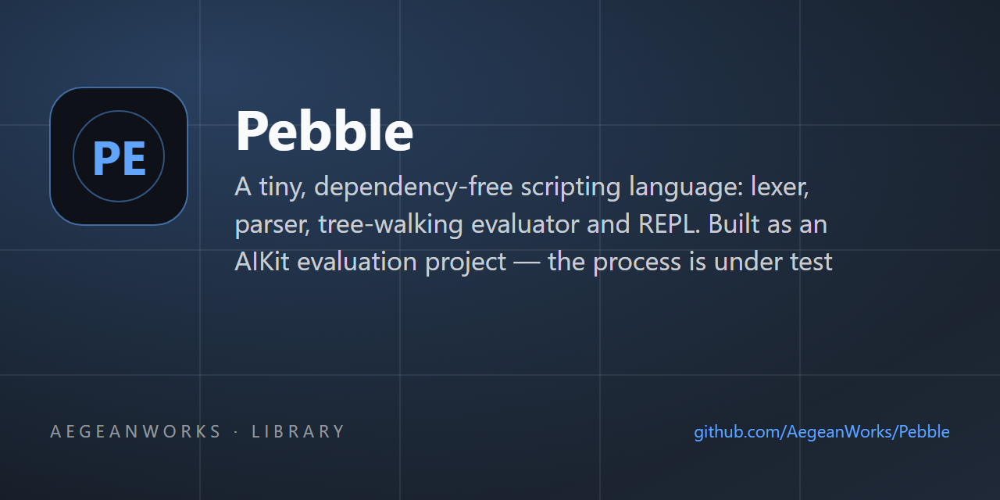

# pebble

<!-- aegean:media:start -->
<p align="center"></p>
*The banner and logo are AI-generated brand assets. They are illustrative and may not literally depict every feature or the full project scope.*
<!-- aegean:media:end -->

[](https://github.com/AegeanWorks/AIKit)

A tiny, dependency-free scripting language: lexer, parser, tree-walking evaluator and REPL.
Built as an AIKit evaluation project — the process is under test as much as the code.

## ⚡ 30-Second Cold-Start Quick Reference

- **Runtime Prerequisites**: Python 3.10 or newer (developed and tested on Python 3.14); nothing else, standard library only
- **Canonical Regression Shield Gate**:
  ```bash
  python -m unittest discover
  ```
- **Run something now** (under 10 seconds):
  ```bash
  python -m pebble examples/fizzbuzz.peb
  python -m pebble -e "print(2 ^ 10)"
  python -m pebble
  ```

### 🛠️ AIKit Commands (run from the AIKit folder)
| Role | Command |
|---|---|
| Status, task and gates | `python aikit.py status pebble` |
| Phase 4: every gate | `python aikit.py check pebble` |
| Repair memory and map, then check | `python aikit.py fix pebble` |
| Resume an interrupted task | `python aikit.py resume pebble` |

## 📦 What's Inside

```text
pebble/
├── .aikit/
│   ├── codebase_map.md       <- generated symbol map, checked on every gate run
│   ├── decisions.md          <- ADRs: surface, builtins, limits and v2 additions
│   ├── guidelines.md         <- project rules (none yet)
│   ├── project.json
│   └── task_ledger.json      <- the task ledger: plan and milestone checkpoints
├── .gitignore
├── LICENSE
├── LICENSES/                 <- REUSE license texts
├── REUSE.toml                <- Machine-readable SPDX metadata
├── README.md
├── COMMERCIAL.md
├── examples/
│   ├── hello.peb
│   ├── greet.peb
│   ├── fizzbuzz.peb
│   └── fibonacci.peb
├── pebble/
│   ├── __init__.py
│   ├── __main__.py           <- `python -m pebble`
│   ├── cli.py                <- file runner, -e, stdin mode and the REPL
│   ├── errors.py             <- every failure renders file:line:col plus Why and Fix
│   ├── evaluator.py          <- tree-walking runtime: scopes, control flow, functions
│   ├── formatting.py         <- type names and the display form of values
│   ├── lexer.py              <- source text to positioned tokens
│   ├── limits.py             <- call, int, range and sequence caps
│   ├── nodes.py              <- the AST: frozen nodes with source positions
│   ├── parser.py             <- recursive-descent parser with positioned errors
│   └── stdlib.py             <- the ten builtins and their arity rules
├── pyproject.toml
└── tests/
    ├── __init__.py
    ├── test_builtins.py
    ├── test_cli.py
    ├── test_evaluator.py
    ├── test_hardening.py
    ├── test_lexer.py
    └── test_parser.py
```

## 🪨 What Pebble is

Pebble is a small scripting language whose errors explain themselves: every failure shows the
file, line and column, why it happened, and how to fix it.

The v1 surface is frozen in [.aikit/decisions.md](.aikit/decisions.md) (ADR-001): numbers,
strings, booleans, lists and `none`; `let`, assignment, `if`/`else`, `while`, `for-in`, `fn`,
`return`; a small operator set; nine builtins; a file runner, `-e` and a REPL. ADR-002 fixes the
builtin semantics and the display form that `print` and `str` share. The v2 increment (ADR-004)
adds `break`/`continue`, list and string slices, `range` with a step, and `float()` as the tenth
builtin. ADR-005 adds command-line script arguments accessible through the global `args` list of
strings; everything else outside those lists waits for a later task.

Status: `task-pebble-core-v1`, `task-pebble-v2-conveniences`, `task-pebble-v3-script-args`,
`task-pebble-v4-finite-floats`, `task-pebble-v4-range-bounds`, and
`task-pebble-v4-residual-guards` are complete (179 tests): script arguments via `args`,
`break`/`continue`, slices, `range` with a step and `float()` extend the frozen v1 surface as
ADR-004 and ADR-005 record. ADR-006 makes every non-finite float result a positioned error,
ADR-007 records that a loop reuses the enclosing scope, ADR-008 computes a range's length before
allocating it, and ADR-009 caps string and list concatenation. The plan and its checkpoints live
in `.aikit/task_ledger.json`.

Pebble stays deliberately bounded (ADR-003, hardened by ADR-006, ADR-008 and ADR-009): calls nest
at most 100 deep, integer exponents stop at 10,000, integers stay near 4,000 digits, and ranges,
repeated sequences and joined sequences stop at 1,000,000 values. Every float result must stay
finite, and an unexpected host failure still renders as a three-line Pebble report rather than a
traceback. Loops add no scope: the loop variable and any `let` inside a loop body remain visible
afterwards.

## 🚀 Running a program

```bash
python -m pebble examples/fizzbuzz.peb   # run a file
python -m pebble examples/greet.peb Alice Bob # pass arguments into 'args'
python -m pebble -e "print(args[0])" hi  # run a command-line program with arguments
python -m pebble                         # REPL on a terminal; piped input runs as a program
```


Exit codes are part of the contract: `0` success, `1` a lexer, parser or runtime error, `2` a
usage or file error. On a terminal the REPL keeps one interpreter alive between inputs, waits for
the rest of an unfinished block, echoes non-`none` expression values, and keeps going after an
error.

## 🧪 Running the tests

```bash
python -m unittest discover
```

Single module, from the project root:

```bash
python -m unittest tests.test_lexer
```

## 📜 License

Free for personal use under the Aegean License 1.1 (AL-1.1); see [LICENSE](LICENSE). Any commercial use needs the Aegean Commercial License 1.0 (ACL-1.0); see [COMMERCIAL.md](COMMERCIAL.md).
